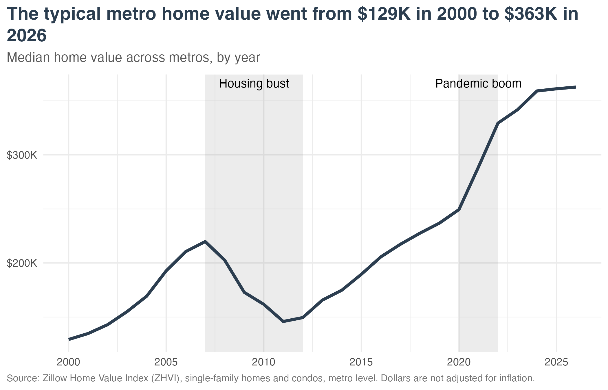
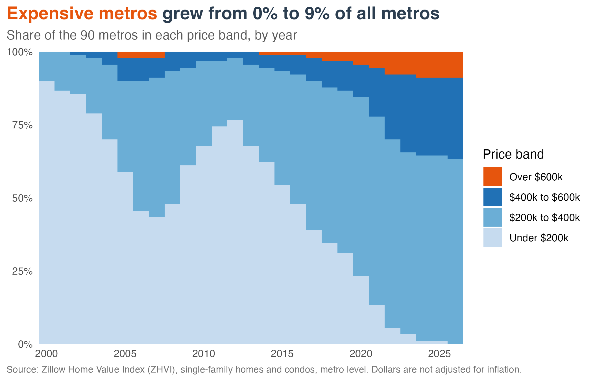
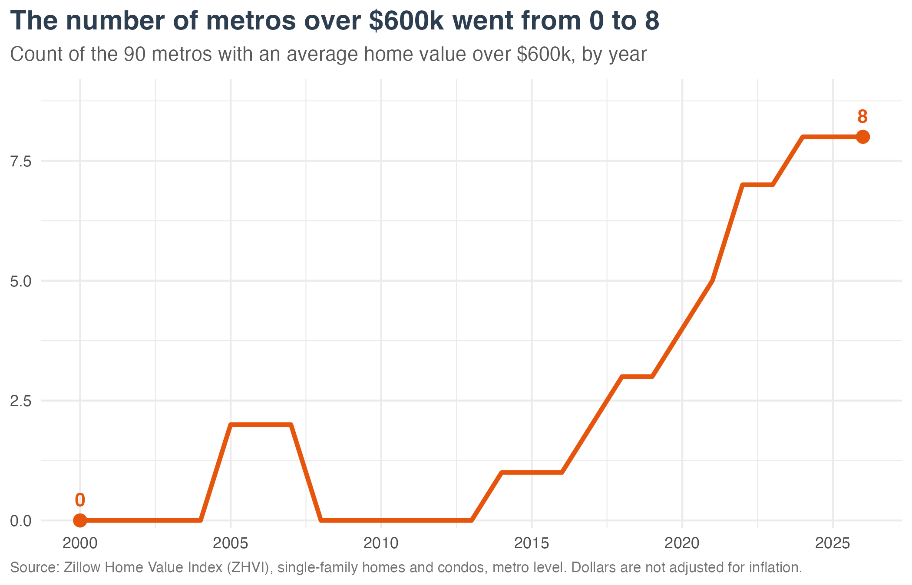
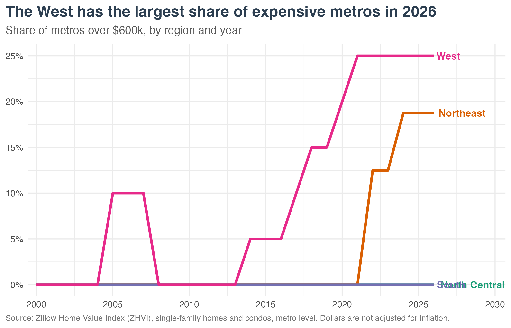
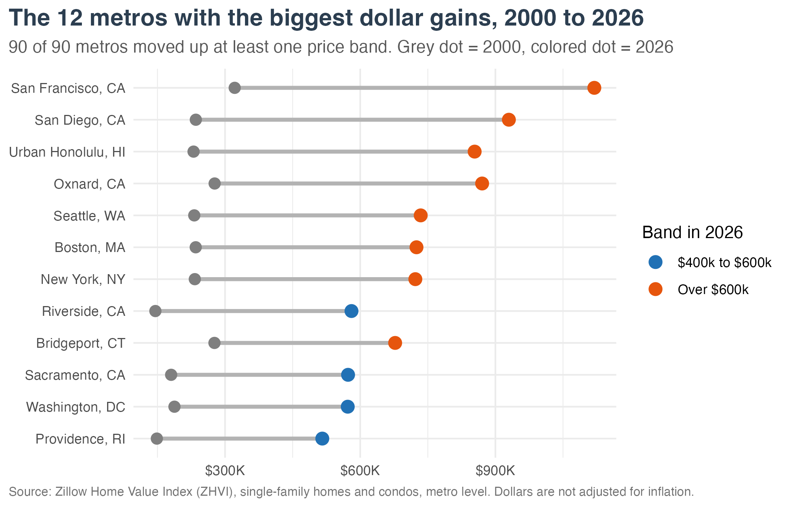
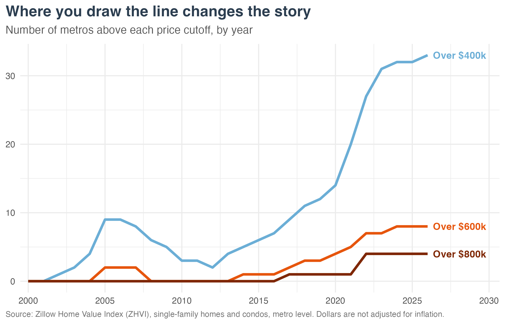

<!-- SETUP LIBRARIES AND FUNCTIONS -->

```{r setup}
#| message: false
#| warning: true
#| include: false

library(here)
library(ggplot2)
library(dplyr)
library(forcats)
library(scales)
library(glue)
library(ggtext)

# Load the custom save-plot function
source(here("pages", "project", "src", "functions", "save_plot_as_png.R"))
```

<!-- DATA BLOCK BELOW -->

```{r data-prep}
#| message: false
#| warning: true
#| include: false

# Cleaned Zillow data: one row per metro per month
zhvi_long <- readRDS(
  here("pages", "project", "data", "cleaned", "zillow_zhvi_sfrcondo_metro_long.Rds")
)

band_levels <- c("Under $200k", "$200k to $400k", "$400k to $600k", "Over $600k")

# One row per metro per year (average of the monthly values)
yearly <- zhvi_long |>
  dplyr::mutate(year = as.integer(format(date, "%Y"))) |>
  dplyr::filter(!is.na(zhvi), !is.na(region)) |>
  dplyr::group_by(region_id, region_name, state_name, region, year) |>
  dplyr::summarise(zhvi = mean(zhvi), .groups = "drop") |>
  dplyr::mutate(
    price_band = cut(
      zhvi,
      breaks = c(0, 200000, 400000, 600000, Inf),
      labels = band_levels
    )
  )

# Keep only metros observed in every year so the mix is comparable over time
n_years <- dplyr::n_distinct(yearly$year)
yearly <- yearly |>
  dplyr::group_by(region_id) |>
  dplyr::filter(dplyr::n() == n_years) |>
  dplyr::ungroup()

first_year <- min(yearly$year)
last_year <- max(yearly$year)
n_metros <- dplyr::n_distinct(yearly$region_id)

# Helpers to format percents and dollars
pct <- function(x) scales::percent(x, accuracy = 1)
usd <- function(x) scales::dollar(x, scale_cut = scales::cut_short_scale())

# Year-level summary used in several plots
by_year <- yearly |>
  dplyr::group_by(year) |>
  dplyr::summarise(
    median_zhvi = median(zhvi),
    n_expensive = sum(price_band == "Over $600k"),
    share_expensive = mean(price_band == "Over $600k"),
    .groups = "drop"
  )

med_first <- by_year$median_zhvi[by_year$year == first_year]
med_last <- by_year$median_zhvi[by_year$year == last_year]
n_exp_first <- by_year$n_expensive[by_year$year == first_year]
n_exp_last <- by_year$n_expensive[by_year$year == last_year]
share_first <- by_year$share_expensive[by_year$year == first_year]
share_last <- by_year$share_expensive[by_year$year == last_year]

# Colors and shared styling
band_cols <- c(
  "Under $200k" = "#C6DBEF",
  "$200k to $400k" = "#6BAED6",
  "$400k to $600k" = "#2171B5",
  "Over $600k" = "#E6550D"
)
exp_col <- band_cols[["Over $600k"]]

source_caption <- "Source: Zillow Home Value Index (ZHVI), single-family homes and condos, metro level. Dollars are not adjusted for inflation."

theme_story <- ggplot2::theme_minimal() +
  ggplot2::theme(
    plot.title = ggtext::element_textbox_simple(
      face = "bold",
      size = 15,
      color = "#2C3E50",
      margin = ggplot2::margin(b = 6)
    ),
    plot.subtitle = ggtext::element_textbox_simple(
      color = "grey35",
      margin = ggplot2::margin(b = 8)
    ),
    plot.caption = ggplot2::element_text(color = "grey45", size = 8, hjust = 0),
    plot.title.position = "plot",
    plot.caption.position = "plot"
  )
```

<!-- STORY BELOW -->

## The question

Over the past two decades, U.S. home values went through a boom, a crash, a slow recovery, and a pandemic surge. This page asks a simple question: **how many metro areas have moved into "expensive" territory, and where did it happen?**

## The data

I use Zillow's Home Value Index (ZHVI), which estimates the typical home value in each metro area each month. The data covers `r n_metros` metros from `r first_year` to `r last_year`. I average each metro's monthly values within a year and sort every metro-year into one of four price bands: under $200k, $200k to $400k, $400k to $600k, and over $600k. I call the top band "expensive."

## 1. The typical metro home

```{r plot-median}
#| echo: false

p_median <- by_year |>
  ggplot2::ggplot(
    data = _,
    mapping = ggplot2::aes(x = year, y = median_zhvi)
  ) +
  ggplot2::annotate("rect", xmin = 2007, xmax = 2012, ymin = -Inf, ymax = Inf, fill = "grey50", alpha = 0.15) +
  ggplot2::annotate("rect", xmin = 2020, xmax = 2022, ymin = -Inf, ymax = Inf, fill = "grey50", alpha = 0.15) +
  ggplot2::geom_line(linewidth = 1.2, color = "#2C3E50") +
  ggplot2::annotate("text", x = 2009.5, y = Inf, label = "Housing bust", vjust = 1.5, size = 3.5) +
  ggplot2::annotate("text", x = 2021, y = Inf, label = "Pandemic boom", vjust = 1.5, size = 3.5) +
  ggplot2::scale_x_continuous(breaks = scales::breaks_pretty(n = 6)) +
  ggplot2::scale_y_continuous(labels = scales::label_dollar(scale_cut = scales::cut_short_scale())) +
  ggplot2::labs(
    title = glue::glue("The typical metro home value went from {usd(med_first)} in {first_year} to {usd(med_last)} in {last_year}"),
    subtitle = "Median home value across metros, by year",
    x = NULL,
    y = NULL,
    caption = source_caption
  ) +
  theme_story

save_plot_as_png(
  plot = p_median,
  file_name = "zillow_median.png"
)
```

{width="100%"}

The typical metro home value rose from `r usd(med_first)` to `r usd(med_last)`. The shaded bands mark the housing bust and the pandemic boom, the two periods that shaped the rest of this story.

## 2. A shifting mix

```{r plot-composition}
#| echo: false

p_comp <- yearly |>
  dplyr::mutate(price_band = forcats::fct_rev(price_band)) |>
  ggplot2::ggplot(
    data = _,
    mapping = ggplot2::aes(x = year, fill = price_band)
  ) +
  ggplot2::geom_bar(position = "fill", width = 1) +
  ggplot2::scale_fill_manual(values = band_cols, name = "Price band") +
  ggplot2::scale_x_continuous(expand = c(0, 0), breaks = scales::breaks_pretty(n = 6)) +
  ggplot2::scale_y_continuous(expand = c(0, 0), labels = scales::label_percent()) +
  ggplot2::labs(
    title = glue::glue("<span style='color:{exp_col}'>Expensive metros</span> grew from {pct(share_first)} to {pct(share_last)} of all metros"),
    subtitle = glue::glue("Share of the {n_metros} metros in each price band, by year"),
    x = NULL,
    y = NULL,
    caption = source_caption
  ) +
  theme_story

save_plot_as_png(
  plot = p_comp,
  file_name = "zillow_composition.png"
)
```

{width="100%"}

Each column adds up to 100% of metros. In `r first_year`, `r pct(share_first)` of metros were in the top band. By `r last_year`, that share was `r pct(share_last)`. Watching the orange layer grow, and the lighter blue layers shrink, is the clearest picture of the change in composition.

## 3. How many metros crossed $600k

```{r plot-count}
#| echo: false

end_points <- by_year |>
  dplyr::filter(year %in% c(first_year, last_year))

p_count <- by_year |>
  ggplot2::ggplot(
    data = _,
    mapping = ggplot2::aes(x = year, y = n_expensive)
  ) +
  ggplot2::geom_line(linewidth = 1.2, color = exp_col) +
  ggplot2::geom_point(data = end_points, size = 3, color = exp_col) +
  ggplot2::geom_text(
    data = end_points,
    mapping = ggplot2::aes(label = n_expensive),
    vjust = -1,
    fontface = "bold",
    color = exp_col
  ) +
  ggplot2::scale_x_continuous(breaks = scales::breaks_pretty(n = 6)) +
  ggplot2::scale_y_continuous(expand = ggplot2::expansion(mult = c(0.02, 0.15))) +
  ggplot2::labs(
    title = glue::glue("The number of metros over $600k went from {n_exp_first} to {n_exp_last}"),
    subtitle = glue::glue("Count of the {n_metros} metros with an average home value over $600k, by year"),
    x = NULL,
    y = NULL,
    caption = source_caption
  ) +
  theme_story

save_plot_as_png(
  plot = p_count,
  file_name = "zillow_count.png"
)
```

{width="100%"}

In raw counts, `r n_exp_first` metros were over $600k in `r first_year` and `r n_exp_last` were by `r last_year`. Looking at the line, you can see when the group of expensive metros grew fastest, and whether the bust and the pandemic boom moved it.

## 4. Where it happened

```{r plot-region}
#| echo: false

region_share <- yearly |>
  dplyr::group_by(year, region) |>
  dplyr::summarise(share = mean(price_band == "Over $600k"), .groups = "drop")

top_region <- region_share |>
  dplyr::filter(year == last_year) |>
  dplyr::slice_max(share, n = 1, with_ties = FALSE) |>
  dplyr::pull(region)

p_region <- region_share |>
  ggplot2::ggplot(
    data = _,
    mapping = ggplot2::aes(x = year, y = share, color = region)
  ) +
  ggplot2::geom_line(linewidth = 1.2) +
  ggplot2::geom_text(
    data = dplyr::filter(region_share, year == last_year),
    mapping = ggplot2::aes(label = region),
    hjust = -0.1,
    fontface = "bold",
    size = 3.5
  ) +
  ggplot2::scale_color_brewer(palette = "Dark2") +
  ggplot2::scale_x_continuous(
    breaks = scales::breaks_pretty(n = 6),
    expand = ggplot2::expansion(mult = c(0.02, 0.18))
  ) +
  ggplot2::scale_y_continuous(labels = scales::label_percent()) +
  ggplot2::labs(
    title = glue::glue("The {top_region} has the largest share of expensive metros in {last_year}"),
    subtitle = "Share of metros over $600k, by region and year",
    x = NULL,
    y = NULL,
    caption = source_caption
  ) +
  theme_story +
  ggplot2::theme(legend.position = "none")

save_plot_as_png(
  plot = p_region,
  file_name = "zillow_region.png"
)
```

{width="100%"}

The rise of expensive metros was not even across the country. Lines are labeled directly at the end so you do not need a legend. By `r last_year`, the **`r top_region`** had the largest share of metros over $600k.

## 5. The biggest movers

```{r plot-movers}
#| echo: false

start <- yearly |>
  dplyr::filter(year == first_year) |>
  dplyr::select(region_id, region_name, zhvi_start = zhvi, band_start = price_band)

end <- yearly |>
  dplyr::filter(year == last_year) |>
  dplyr::select(region_id, zhvi_end = zhvi, band_end = price_band)

metro_change <- dplyr::inner_join(start, end, by = "region_id") |>
  dplyr::mutate(
    gain = zhvi_end - zhvi_start,
    bands_moved = as.integer(band_end) - as.integer(band_start)
  )

n_moved_up <- sum(metro_change$bands_moved > 0)

top_gainers <- metro_change |>
  dplyr::slice_max(gain, n = 12) |>
  dplyr::mutate(region_name = forcats::fct_reorder(region_name, gain))

p_movers <- top_gainers |>
  ggplot2::ggplot(data = _) +
  ggplot2::geom_segment(
    mapping = ggplot2::aes(x = zhvi_start, xend = zhvi_end, y = region_name, yend = region_name),
    color = "grey70",
    linewidth = 1.2
  ) +
  ggplot2::geom_point(
    mapping = ggplot2::aes(x = zhvi_start, y = region_name),
    color = "grey50",
    size = 3
  ) +
  ggplot2::geom_point(
    mapping = ggplot2::aes(x = zhvi_end, y = region_name, color = band_end),
    size = 3.5
  ) +
  ggplot2::scale_color_manual(values = band_cols, name = glue::glue("Band in {last_year}")) +
  ggplot2::scale_x_continuous(labels = scales::label_dollar(scale_cut = scales::cut_short_scale())) +
  ggplot2::labs(
    title = glue::glue("The 12 metros with the biggest dollar gains, {first_year} to {last_year}"),
    subtitle = glue::glue("{n_moved_up} of {n_metros} metros moved up at least one price band. Grey dot = {first_year}, colored dot = {last_year}"),
    x = NULL,
    y = NULL,
    caption = source_caption
  ) +
  theme_story

save_plot_as_png(
  plot = p_movers,
  file_name = "zillow_movers.png"
)
```

{width="100%"}

Overall, `r n_moved_up` of the `r n_metros` metros moved up at least one price band between `r first_year` and `r last_year`. The chart shows the 12 metros that gained the most in dollars, and the color of the end point shows which band each one ended in.

## 6. A caveat: where you draw the line matters

```{r plot-threshold}
#| echo: false

thresholds <- c(400000, 600000, 800000)

threshold_counts <- dplyr::bind_rows(
  lapply(thresholds, function(th) {
    yearly |>
      dplyr::group_by(year) |>
      dplyr::summarise(n_over = sum(zhvi > th), .groups = "drop") |>
      dplyr::mutate(cutoff = paste0("Over $", th / 1000, "k"))
  })
)

p_threshold <- threshold_counts |>
  ggplot2::ggplot(
    data = _,
    mapping = ggplot2::aes(x = year, y = n_over, color = cutoff)
  ) +
  ggplot2::geom_line(linewidth = 1.2) +
  ggplot2::geom_text(
    data = dplyr::filter(threshold_counts, year == last_year),
    mapping = ggplot2::aes(label = cutoff),
    hjust = -0.1,
    fontface = "bold",
    size = 3.5
  ) +
  ggplot2::scale_color_manual(values = c("#6BAED6", "#E6550D", "#7F2704")) +
  ggplot2::scale_x_continuous(
    breaks = scales::breaks_pretty(n = 6),
    expand = ggplot2::expansion(mult = c(0.02, 0.18))
  ) +
  ggplot2::labs(
    title = "Where you draw the line changes the story",
    subtitle = "Number of metros above each price cutoff, by year",
    x = NULL,
    y = NULL,
    caption = source_caption
  ) +
  theme_story +
  ggplot2::theme(legend.position = "none")

save_plot_as_png(
  plot = p_threshold,
  file_name = "zillow_threshold.png"
)
```

{width="100%"}

The $600k line is my choice, and a different cutoff gives a different count. These values are also nominal dollars, so some of the move into higher bands reflects general inflation and not only real price growth. A cutoff of $400k tells a more crowded story than a cutoff of $800k, which is why I show all three here.

## Takeaways

- The typical metro home value went from `r usd(med_first)` in `r first_year` to `r usd(med_last)` in `r last_year`.
- The share of metros in the expensive band rose from `r pct(share_first)` to `r pct(share_last)`, and `r n_moved_up` of `r n_metros` metros moved up at least one price band.
- The **`r top_region`** had the largest share of expensive metros in `r last_year`, so the change was not even across regions.
- The size of the "expensive" group depends on where you set the cutoff, and prices are not adjusted for inflation, so the results should be read as a pattern and not an exact count.
